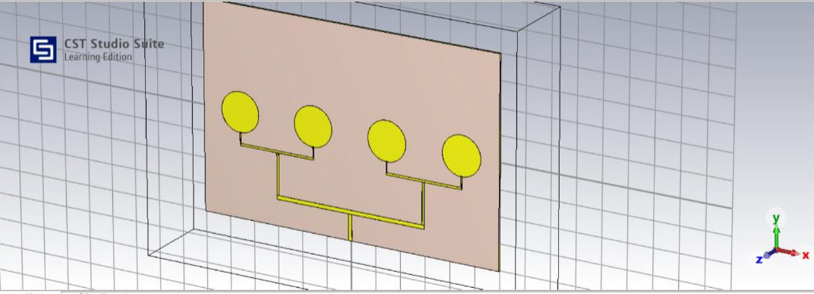
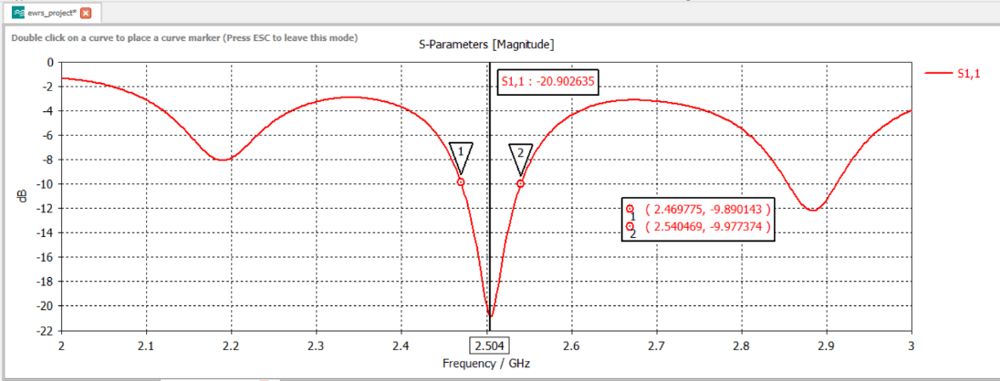
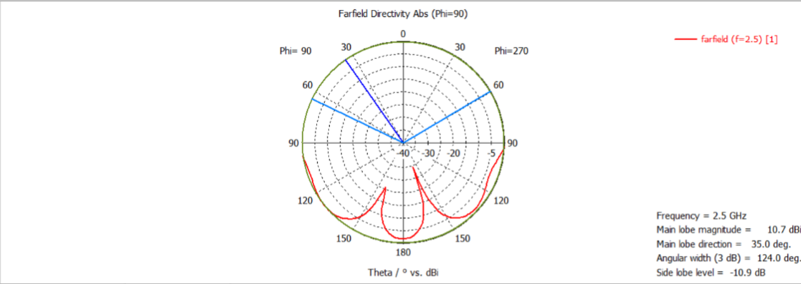
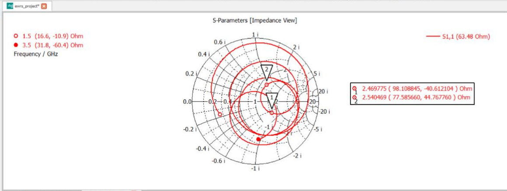
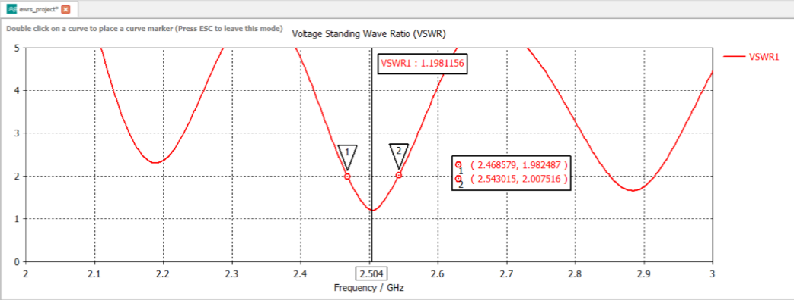

# 4-Element Circular Microstrip Patch Antenna Array

  <strong>RF & Microwave Engineering | Antenna Design | CST Studio Suite</strong>

  Electromagnetic design and simulation of a four-element circular microstrip patch antenna array operating at 2.5 GHz.

---

## Project Overview

Microstrip patch antennas are widely used in wireless communication systems because of their compact size, low profile, lightweight construction, and compatibility with printed circuit board fabrication.

However, a single patch antenna can have limited gain and bandwidth. This project investigates a four-element circular microstrip patch antenna array designed to improve directional radiation and gain through multiple radiating elements connected by a corporate feed network.

The antenna is designed and simulated using **CST Studio Suite**, with performance evaluated through S-parameters, return loss, Voltage Standing Wave Ratio (VSWR), Smith chart representation, and far-field radiation characteristics.

## Project Information

| Attribute | Details |
|---|---|
| Project title | 4-Element Circular Microstrip Patch Antenna Array |
| Project type | EWRS Minor Project |
| Academic year | 2025–2026 |
| Department | Electronics & Telecommunication Engineering |
| Institution | Pillai College of Engineering |
| Simulation software | CST Studio Suite |
| Target frequency | 2.5 GHz |
| Substrate | FR-4 |
| Array configuration | Four circular radiating patches |
| Feeding technique | Corporate feed network |

## Objectives

- Design a four-element circular microstrip patch antenna array for operation at 2.5 GHz.
- Develop an antenna structure using an FR-4 dielectric substrate.
- Implement a corporate feed network for distributing input power among the radiating elements.
- Simulate the electromagnetic behavior of the antenna in CST Studio Suite.
- Analyze return loss, S11, VSWR, impedance matching, and far-field radiation patterns.
- Investigate the potential benefits and limitations of an antenna array for wireless communication.

## Design Specifications

The following parameters are documented in the project report.

| Parameter | Value |
|---|---|
| Design frequency | 2.5 GHz |
| Relative permittivity, εr | 4.4 |
| Substrate thickness, h | 1.6 mm |
| Number of radiating elements | 4 |
| Initial calculated patch radius | Approximately 16.27 mm |
| Optimized patch radius | 15.4 mm |
| Nominal free-space wavelength | 120 mm |
| Nominal element spacing | 60 mm |
| Substrate material | FR-4 |

The dimensions were calculated and the patch radius was optimized for the intended operating frequency. Final performance depends on the complete geometry, feed network, material properties, and simulation settings.

## Antenna Design Methodology

The design process follows these stages:

1. **Parameter selection:** Establish the target frequency, substrate permittivity, and substrate thickness.
2. **Initial calculations:** Calculate the wavelength and estimate the circular patch dimensions.
3. **Geometry development:** Model four circular radiating patches on an FR-4 substrate.
4. **Feed network design:** Connect the elements through a corporate feed arrangement intended to distribute power.
5. **Simulation setup:** Define the frequency range, materials, excitation port, boundaries, and solver settings.
6. **Electromagnetic simulation:** Run the CST simulation to obtain S-parameters and radiation characteristics.
7. **Result analysis:** Examine return loss, VSWR, Smith chart representation, and far-field directivity.
8. **Optimization:** Adjust antenna dimensions and feed parameters to improve performance near the target frequency.

## Design Calculations

### 1. Free-Space Wavelength

The free-space wavelength is calculated using:

\[
\lambda_0 = \frac{c}{f}
\]

where:

- \(c = 3 \times 10^8\) m/s
- \(f = 2.5 \times 10^9\) Hz

Therefore:

\[
\lambda_0 = \frac{3 \times 10^8}{2.5 \times 10^9}
= 0.12 \text{ m}
\]

\[
\boxed{\lambda_0 = 120 \text{ mm}}
\]

### 2. Initial Effective Wavelength Estimate

The report uses the following estimate:

\[
\lambda_{\mathrm{eff}} \approx
\frac{\lambda_0}{\sqrt{\varepsilon_r}}
\]

Substituting the design values:

\[
\lambda_{\mathrm{eff}} \approx
\frac{120}{\sqrt{4.4}}
\approx 57.2 \text{ mm}
\]

This is the estimate used in the report; the effective wavelength in a practical microstrip structure depends on its effective dielectric constant.

### 3. Initial Element Spacing

The report uses half the free-space wavelength as the nominal spacing:

\[
d = \frac{\lambda_0}{2}
\]

\[
\boxed{d = 60 \text{ mm}}
\]

### 4. Circular Patch Radius

The report gives an initial calculated radius of approximately 16.27 mm, followed by an optimized radius of:

\[
\boxed{a = 15.4 \text{ mm}}
\]

The final radius is used as the optimized design value reported for the antenna.

## System Design and Simulation

### CST Studio Suite

CST Studio Suite is used to construct and simulate the antenna structure in three dimensions.

The simulation workflow documented in the report includes:

- Creating the substrate and assigning FR-4 material properties.
- Defining the metallic ground plane and radiating patches.
- Constructing the corporate feed network.
- Defining the excitation port and open radiation boundaries.
- Configuring the simulation frequency range and solver.
- Running the electromagnetic simulation.
- Inspecting the resulting S-parameters and radiation characteristics.

## Simulation Results

The project report presents the following simulation outputs. Add the corresponding original CST screenshots to the repository to make the results reproducible and easy to inspect.

### 1. CST Antenna Model

The model illustrates four circular radiating elements connected through a feed network on the substrate.

### 2. S11 and Return Loss

The S11 response indicates how much of the incident signal is reflected at the antenna input.

A lower S11 value in decibels generally indicates better impedance matching. The report describes the design as achieving a return loss below -20 dB at its intended operating point.

### 3. Far-Field Radiation Pattern

The far-field radiation pattern shows how the radiated field varies with direction. The report describes directional radiation from the four-element array.

### 4. Smith Chart

The Smith chart provides a graphical representation of input impedance and reflection characteristics, helping assess impedance matching near the target frequency.

### 5. Voltage Standing Wave Ratio

VSWR indicates the degree of mismatch between the antenna input and the transmission line.

A VSWR approaching 1 indicates better matching. The report describes the simulated VSWR as being close to unity near the intended operating frequency.

### Results Summary

| Parameter | Reported outcome |
|---|---|
| Operating frequency | 2.5 GHz design target |
| Return loss | Report reports S11 below -20 dB in its conclusion |
| VSWR | Report describes it as close to 1 |
| Radiation pattern | Directional characteristics reported |
| Gain and directivity | Improvement expected from the array configuration |
| Physical fabrication and measurement | Not documented in the supplied report |

Exact gain, bandwidth, efficiency, and measured antenna performance should be added only when supported by numerical simulation exports or physical measurement data.

## Advantages

- Improved gain potential compared with a single radiating element.
- Increased directivity through array configuration.
- Compact, low-profile antenna construction.
- Compatibility with PCB-based manufacturing techniques.
- Convenient electromagnetic analysis and optimization using CST Studio Suite.
- Potential integration with wireless communication and RF systems.

## Limitations

- The corporate feed network increases design complexity.
- FR-4 dielectric losses may affect radiation efficiency.
- Microstrip patch antennas generally have limited bandwidth.
- Small fabrication variations can shift the resonant frequency.
- Mutual coupling between adjacent elements can affect array performance.
- Feed-network asymmetry can alter the intended radiation pattern.

## Applications

Potential applications include:

- Wi-Fi and WLAN systems operating in the relevant frequency range.
- Wireless communication systems.
- IoT communication devices.
- RF prototyping and antenna research.
- Selected ISM-band applications, subject to the applicable regional frequency allocation.

Actual suitability for a specific application requires verification of operating frequency, bandwidth, gain, efficiency, polarization, and regulatory requirements.

## Future Improvements

- Export exact S11, VSWR, gain, and bandwidth values from CST.
- Optimize feed dimensions and element spacing.
- Investigate mutual coupling between adjacent patches.
- Compare array performance with a single circular patch antenna.
- Evaluate radiation efficiency and realized gain.
- Study sensitivity to FR-4 material tolerances.
- Fabricate the antenna and compare measurements with simulated results.

## Tools and Technologies

- **CST Studio Suite:** Three-dimensional electromagnetic modeling and simulation.
- **RF and microwave engineering:** Antenna theory, impedance matching, and radiation analysis.
- **Microstrip design:** Circular patches, dielectric substrate, ground plane, and corporate feed network.

## Project Team

**Atharva Jadhav**  
**Deevy Bhanushali**

Department of Electronics & Telecommunication Engineering  
Pillai College of Engineering  
Academic Year 2025–2026

**Project Supervisor:** Dr. Suman Wadkar

## References

1. C. A. Balanis, *Antenna Theory: Analysis and Design*, 4th ed. Hoboken, NJ, USA: Wiley, 2016.
2. D. M. Pozar, “Microstrip antennas,” *Proceedings of the IEEE*, vol. 80, no. 1, pp. 79–91, Jan. 1992.

---

*This repository documents the antenna design and electromagnetic simulation work described in the project report. The results presented are simulation findings; physical fabrication and experimental validation are not claimed.*
